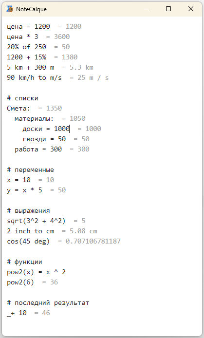
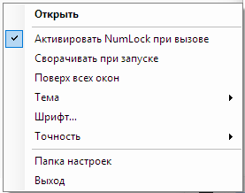

# NoteCalque

Current version **1.0.5.0**.

[Русский README](README.md)

A calculator notepad inspired by calque.io. Type expressions and see results on the same line. NoteCalque lives in the Windows system tray, opens with **NumLock**, and saves your notes between sessions.

Based on Numlock Calculator by Vladimir Potapov and Karluk. Calculations use math.js 15.2.0.

Double-click a result to copy its value to the clipboard without the equals sign.



## Changes in 1.0.5.0

- Added an English interface. NoteCalque selects Russian for a Russian Windows display language and English for all other display languages when it starts.
- Added this English README.

## Changes in 1.0.4.0

- Scroll to the end of saved notes after the initial window layout.
- Prevent synthetic NumLock events from triggering the window hotkey again.
- Restore NumLock after opening and cancel pending restoration when hiding the window.
- Fix detection of a held NumLock key.

## Changes in 1.0.3.0

- Double-click a result to copy its value without the equals sign.

## Changes in 1.0.2.0

- Fix function calls using variables, including `sqrt(x)`, `abs(x)`, nested calls, and Cyrillic function names.
- Show a short error label with the full error message on hover.
- Add a per-user Windows startup option and a link to the project page in the tray menu.

## Requirements and installation

Windows, **.NET Framework 4.8**, and **Microsoft Edge WebView2 Runtime** are required.

Extract the Windows archive and run `NoteCalque.exe`. The archive includes the executable, its configuration file, both READMEs, screenshots, and license notices. Install WebView2 Runtime before starting NoteCalque if it is missing.

- [Download WebView2 Runtime from Microsoft](https://developer.microsoft.com/microsoft-edge/webview2/#download-section).
- [Evergreen Bootstrapper](https://go.microsoft.com/fwlink/p/?LinkId=2124703) detects the architecture and downloads the runtime.
- For offline installation, choose the Evergreen Standalone Installer on the Microsoft download page, using x64 for 64-bit Windows or x86 for 32-bit Windows.

## Calculations

Results appear immediately after each expression.

```text
price = 1200        = 1200
price * 3           = 3600
20% of 250          = 50
1200 + 15%          = 1380
5 km + 300 m        = 5.3 km
90 km/h to m/s      = 25 m / s

Estimate:           = 800
  materials = 500   = 500
  labor = 300       = 300
```

A heading ending with a colon sums the more deeply indented entries beneath it. Variables are shared across the entire note and can use Cyrillic names. Plain text and headings can sit between calculations.

The previous result is available as `_`, `last`, or `ans`. Functions accept variables and previous results.

```text
x = 10       = 10
sqrt(x)      = 3.16227766017
sqrt(_)      = 1.77827941004
```

An invalid expression displays **Error**. Hover over the label to read the full message from the calculation engine.

Typing `+`, `-`, `*`, `/`, or `^` at the beginning of an empty line automatically inserts `_` before the operator to continue from the previous result.

```text
10 / 3       = 3.33333333333
_*3          = 10
```

This uses the full previous value, preserving precision through subsequent calculations. `_` is a regular math.js variable name. The question mark is reserved for its ternary operator.

**Tab** indents the current line or selected lines. **Shift+Tab** removes indentation. Indentation determines which entries belong to a subtotal heading.

## Settings

Right-click the NoteCalque icon near the Windows clock to open its tray menu.



Choose a system, light, or dark theme, editor font, and result precision. You can also enable **Start minimized**, **Always on top**, and **Enable NumLock when opening**.

**Start with Windows** launches NoteCalque when the current user signs in. It stores a `NoteCalque` entry under `HKCU\Software\Microsoft\Windows\CurrentVersion\Run`. Disabling the option removes that entry. If you move the executable, toggle the option off and on to update its path.

The **NoteCalque 1.0.5.0** menu item opens the project page on GitHub. **Settings folder** opens the folder containing your saved notes and preferences. **Exit** closes the application.

Preferences are saved automatically. Result precision is measured in significant digits and defaults to 12. The application selects its language from the Windows display language at startup, using Russian for `ru` and English for other languages.

## NumLock and window behavior

Press **NumLock** to show the calculator. Press it again while the calculator is active to hide it. Closing or minimizing the window also hides it in the tray. Use **Exit** in the tray menu to quit.

NoteCalque combines a low-level keyboard hook (`WH_KEYBOARD_LL`) and `RegisterHotKey`. The hook lets the physical key through and sends a compensating NumLock event. Duplicate hotkey messages are filtered using the original input timestamps. The hook also handles numeric keypad state recovery while the calculator is active. See the comments in `Src/KeyboardHook.cs` for details.

Starting a second copy asks the running instance to show its window. A named mutex prevents multiple instances from installing competing keyboard hooks.

## Project structure

| Folder | Contents |
|---|---|
| `Src/` | Window, tray, keyboard handling, language selection, and settings in C# and WinForms targeting .NET Framework 4.8 |
| `Web/` | Editor layout and JavaScript calculations hosted in WebView2 |
| `tests/` | Calculation, editor, language, and hotkey regression tests |

The editor uses a textarea and a matching overlay with transparent expression text and visible results. Both layers share font metrics, line height, padding, and scroll position.

The executable embeds the HTML, JavaScript, WebView2 managed assemblies, and native loader. Managed assemblies are loaded through `AssemblyResolve`. Web assets and the native loader are extracted to `%AppData%\NoteCalque\web` and `%AppData%\NoteCalque\native`.

Notes and settings are stored in `%AppData%\NoteCalque\settings.xml`. This location is independent of the executable path and version.

## Build and tests

Open `NoteCalque.sln` in Visual Studio and build it. NuGet restores the WebView2 SDK and .NET Framework 4.8 reference assemblies. The reference assemblies package supplies the build references without a separate Developer Pack installation.

From a Visual Studio developer shell, run

```powershell
msbuild NoteCalque.csproj -t:Restore
msbuild NoteCalque.csproj -p:Configuration=Release
```

Run the tests from the repository root after building the Release configuration. JavaScript tests require Node.js.

```powershell
node tests/calc.test.js
node tests/result-copy.test.js
node tests/startup-scroll.test.js
node tests/language.test.js
powershell -NoProfile -ExecutionPolicy Bypass -File tests/ui-language.test.ps1
powershell -NoProfile -ExecutionPolicy Bypass -File tests/hotkey-routing.test.ps1
```

## License

NoteCalque is distributed under **GNU GPL version 3 only**, SPDX `GPL-3.0-only`. The full text is in [LICENSE](LICENSE).

The application includes code from Numlock Calculator (NoteCalc), copyright © 2009 Vladimir Potapov, Karluk, www.keleg.info. The original project was published under GNU GPL without a version number. NoteCalque uses version 3. NoteCalque changes are copyright © 2026 contributors.

Third-party components retain their respective licenses.

- math.js 15.2.0, Apache 2.0, Jos de Jong. See [its license](Web/mathjs-LICENSE.txt) and [bundled component notices](Web/math.js.LICENSE.txt).
- WebView2 SDK 1.0.4191.47, BSD 3-Clause, Microsoft. See [its license](licenses/WebView2-LICENSE.txt) and [notices](licenses/WebView2-NOTICE.txt).
